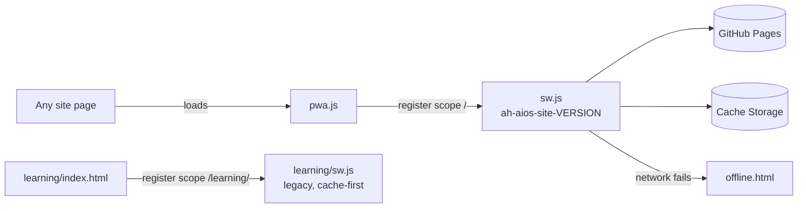
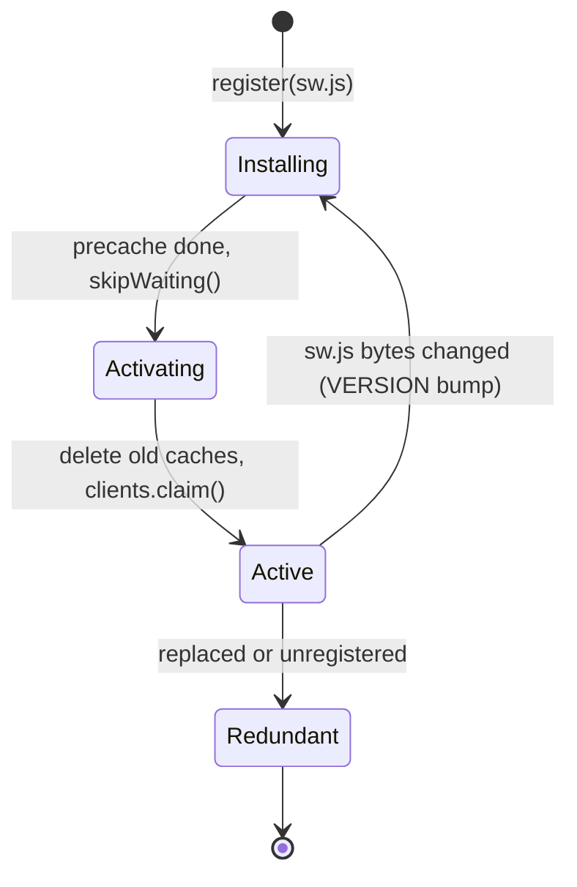
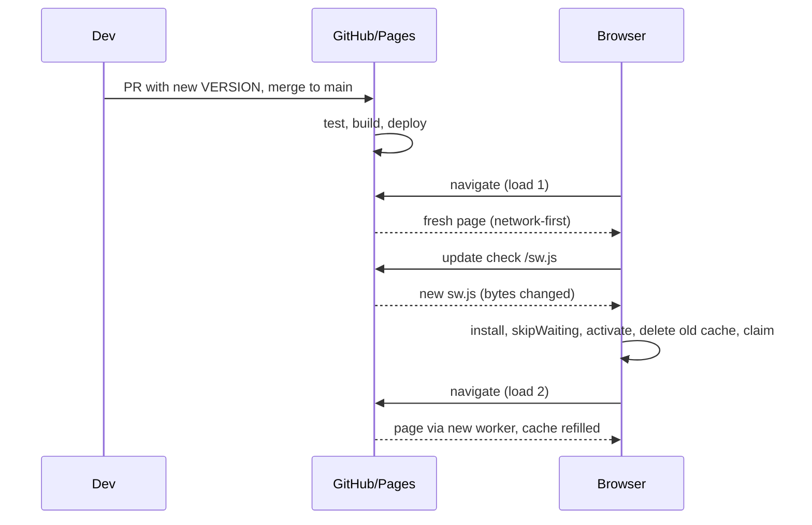
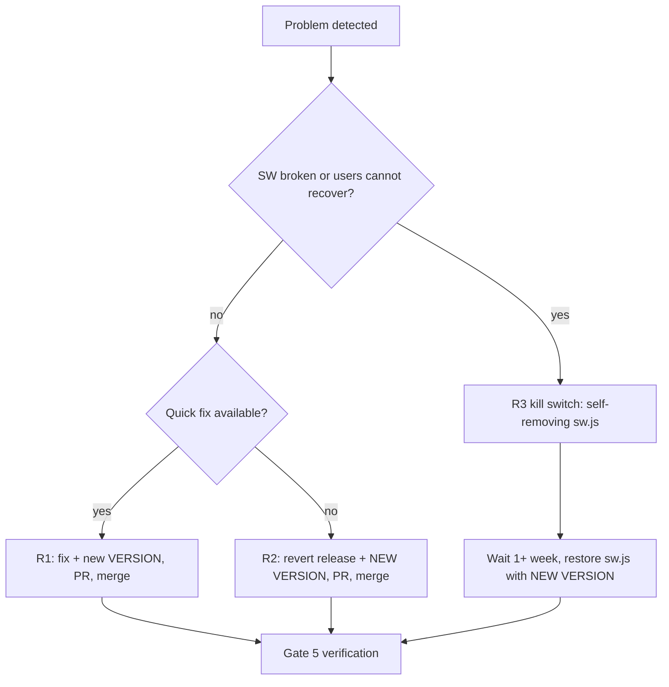

# AH-AIOS PWA Operations and Release Guide

| | |
|---|---|
| **Document** | `docs/PWA_OPERATIONS_GUIDE.md` |
| **Applies to** | AH-AIOS site release 0.5.1, service worker `VERSION` `0.5.1-pwa1` |
| **Repository / site** | `hydraporss/ah-aios-react-website` → https://hydraporss.github.io/ah-aios-react-website/ |
| **Last evidence date** | 2026-11-02 |
| **Companion document** | [`DEPLOYMENT-RUNBOOK.md`](DEPLOYMENT-RUNBOOK.md) (release-branch, backup, hash-inventory and PR process; this guide adds the PWA-specific steps) |

> **Evidence convention.** *Verified* means a result was observed and recorded. *Expected* means the behaviour follows from the browser's documented design but has **not** been observed on this site. Nothing marked *Expected* may be reported as passed.

---

## Contents

1. [Executive summary](#1-executive-summary)
2. [Production QA test sheet](#2-production-qa-test-sheet)
3. [Cross-browser test matrix](#3-cross-browser-test-matrix)
4. [GitHub Pages deployment runbook](#4-github-pages-deployment-runbook)
5. [Service worker operations guide](#5-service-worker-operations-guide)
6. [Service worker update diagram](#6-service-worker-update-diagram)
7. [Risk register](#7-risk-register)
8. [Production readiness score](#8-production-readiness-score)
9. [Release gates](#9-release-gates)
10. [Final verdict](#10-final-verdict)
11. [Executive recommendation](#11-executive-recommendation)

---

## 1. Executive summary

**Purpose.** Make the whole AH-AIOS static site installable ("Add to Home Screen" / "Install app") and usable offline after a first visit, without changing any page content or adding a build step.

**Scope.**

| In scope | Out of scope (unchanged by design) |
|---|---|
| `manifest.webmanifest`, `sw.js`, `pwa.js`, `offline.html` at the site root | `learning/index.html` (keeps its own manifest and `/learning/` service worker) |
| Icons in `assets/pwa/`: 192, 512, maskable 512, Apple touch icon | `404.html` (served at arbitrary depths on Pages) |
| `scripts/add-pwa.js` (idempotent injector; applied to 57 pages) | `AH-AIOS-Standalone.html` architecture (single file, no service worker) |
| Manifest shortcuts: Hub, Learning Studio, AI Harness | Desktop (Electron) app, Flask backend, `archive/` |

**Current maturity: Level 3 of 5 — "Functionally complete, locally verified."**

| Level | Meaning | Status |
|---|---|---|
| 1 | Prototype | passed |
| 2 | Works in one browser | passed |
| 3 | Functionally complete, automated checks pass, local browser evidence | **current** |
| 4 | Cross-browser and staging verified | not reached |
| 5 | Production-proven, monitored | not reached |

**What is verified (2026-11-02).**

- `npm run verify` passes: 75/75 unit tests, link check on 61 pages, Flask sync, release check on 433 manifest entries (155 embedded standalone files compared).
- Chromium (headless, Playwright, `localhost`): manifest and all four icons load (HTTP 200, correct types); the service worker registers and controls pages; with the **server stopped**, previously visited pages (home, hub, AI Harness, Core domain, WorldForge) load from cache, an unvisited page shows `offline.html`, and the `start_url` with `?source=pwa` works offline.
- Interaction test: after visiting `learning/index.html`, two workers are active (`/sw.js` for `/`, `/learning/sw.js` for `/learning/`). Pages under `/learning/` are controlled by the **legacy** worker (see R-01).

**What is not verified.** Android and iOS install, Safari, Firefox, Edge, the GitHub Pages deployment itself, the update path from one `VERSION` to the next, and Lighthouse.

**Deployment recommendation.** **Proceed to a staging deployment now; promote to production once the two conditions below are closed.** The failure mode is benign for a static site (worst case: stale content), and rollback is a documented re-deploy.

1. **C-1:** Put `/learning/` under a single cache policy (R-01).
2. **C-2:** Make the cache-version bump enforced or automatic instead of a manual memory item (R-02).

---

## 2. Production QA test sheet

**Severity if failed:** *Critical* = release blocker; *High* = blocker unless waived in writing; *Medium* = fix before the next release; *Low* = log and schedule. Mark `☐` → `✔` (pass) or `✘` (fail). Record browser, version, OS and build/commit in **Notes**. "SW" = service worker. Use the DevTools **Application → Service Workers → Offline** checkbox (or stop the server); Playwright's offline switch does not reliably block a service worker's own requests.

### 2.1 Installability and assets

| ID | Category | Test description | Expected result | Severity if failed | Pass/Fail | Notes |
|---|---|---|---|---|---|---|
| PWA-INS-01 | Manifest | Open `/manifest.webmanifest` | HTTP 200, valid JSON, `name` "AH-AIOS Learning App Studio", `scope` `./`, `display` `standalone` | High | ☐ | Verified 2026-11-02 on localhost (Chromium) |
| PWA-INS-02 | Manifest | DevTools → Application → Manifest | No errors or warnings; "Installability" shows no blockers | Medium | ☐ | Not yet run in DevTools |
| PWA-INS-03 | Icons | Request each icon in the manifest (192, 512, maskable 512, SVG) | All HTTP 200; `image/png` / `image/svg+xml` | Medium | ☐ | Verified 2026-11-02 on localhost |
| PWA-INS-04 | Icons | Preview maskable icon in maskable.app or DevTools | Logo fully inside the safe zone, no clipping | Low | ☐ | Glyph drawn at 62% scale |
| PWA-INS-05 | Icons | `GET /assets/pwa/apple-touch-icon.png` | 200, 180×180 PNG, opaque background | Low | ☐ | |
| PWA-INS-06 | Page tags | View source of `index.html`, `hub.html`, `harness/home.html` | `<link rel="manifest">`, `apple-touch-icon`, `theme-color`, `<script … pwa.js defer data-ah-pwa>` present with correct relative depth | High | ☐ | 57 pages tagged |
| PWA-INS-07 | Install | Chrome/Edge desktop: install from address bar | App opens in its own window, correct name and icon | High | ☐ | |
| PWA-INS-08 | Shortcuts | Right-click installed icon (desktop) / long-press (Android) | Hub, Learning Studio, AI Harness listed; each opens the right page | Low | ☐ | |
| PWA-INS-09 | Start URL | Launch installed app | Opens `index.html?source=pwa` inside scope, no browser UI | Medium | ☐ | |

### 2.2 Service worker lifecycle

| ID | Category | Test description | Expected result | Severity if failed | Pass/Fail | Notes |
|---|---|---|---|---|---|---|
| PWA-SW-01 | Registration | Load `index.html` on `http://localhost` or HTTPS | `/sw.js` registered; scope = site root; status "activated and running" | Critical | ☐ | Verified 2026-11-02 |
| PWA-SW-02 | Control | Reload once after first load | `navigator.serviceWorker.controller` is set | High | ☐ | Verified 2026-11-02 |
| PWA-SW-03 | Cache name | Application → Cache Storage | Exactly one `ah-aios-site-<VERSION>` cache (plus `ah-aios-learning-studio-*` if `/learning/` was visited) | Medium | ☐ | Verified: `ah-aios-site-0.5.1-pwa1` |
| PWA-SW-04 | Precache | Inspect cache after install | `index.html`, `hub.html`, `offline.html`, `manifest.webmanifest`, `pwa.js`, 4 icons, `learning/icon.svg` present | High | ☐ | Install tolerates individual failures; confirm none missing |
| PWA-SW-05 | Scope on Pages | Register on the project URL `/ah-aios-react-website/` | Scope is `/ah-aios-react-website/`, not `/` | Critical | ☐ | Not yet run on Pages |
| PWA-SW-06 | Frames | Open a page inside an iframe (hub embeds) | No second registration from the frame | Low | ☐ | Guard: `self !== top` |
| PWA-SW-07 | `file://` | Open `index.html` from disk | No errors; no registration | Medium | ☐ | Guard: protocol must be http(s) |
| PWA-SW-08 | Standalone | Open `AH-AIOS-Standalone.html` | Works as before; no registration; no console errors from `pwa.js` | High | ☐ | `pwa.js` embedded for resolution only |
| PWA-SW-09 | Legacy worker | Visit `learning/index.html`, then `learning/domains/core.html` | Controller for `/learning/*` is `/learning/sw.js`; `hub.html` controller is `/sw.js` | High | ☐ | Verified 2026-11-02; this is **R-01** |

### 2.3 Offline behaviour

| ID | Category | Test description | Expected result | Severity if failed | Pass/Fail | Notes |
|---|---|---|---|---|---|---|
| PWA-OFF-01 | Visited page | Visit Home, Hub, AI Harness home, Core domain, WorldForge while SW controls; go offline; reload each | Each loads with full content | Critical | ☐ | Verified 2026-11-02 (server stopped) |
| PWA-OFF-02 | Unvisited page | Offline, open a page never visited | `offline.html` shown with links to Home, Hub, Learning | High | ☐ | Verified 2026-11-02 |
| PWA-OFF-03 | Start URL | Offline, open `index.html?source=pwa` | Home loads (query ignored on cache fallback) | High | ☐ | Verified 2026-11-02 |
| PWA-OFF-04 | Assets | Offline, fetch a previously used icon/CSS/JS | HTTP 200 from cache | Medium | ☐ | Verified for icon |
| PWA-OFF-05 | First-visit gap | Fresh profile: load one page, go offline **without** reloading or visiting a second page | Only precached pages (Home, Hub) are available | Low | ☐ | By design: a page is cached only if fetched while the SW controls it |
| PWA-OFF-06 | Recovery | Go back online, reload | Fresh content served (network-first) | High | ☐ | |
| PWA-OFF-07 | Redirect | Offline, open `/learning` (no slash) after visiting it online | Resolves to the Learning Studio | Medium | ☐ | Passed 2026-11-02, but the legacy worker may have served it (R-07) |
| PWA-OFF-08 | Server error | Online, request a non-existent page | Server 404 returned as-is (GitHub Pages `404.html`); not cached | Low | ☐ | The worker does not substitute `offline.html` for HTTP errors |

### 2.4 Update and cache invalidation

| ID | Category | Test description | Expected result | Severity if failed | Pass/Fail | Notes |
|---|---|---|---|---|---|---|
| PWA-UPD-01 | Version bump | Change `VERSION` in `sw.js`, deploy, reload twice | New `sw.js` installs and activates; old `ah-aios-site-*` cache deleted; new cache populated | Critical | ☐ | **Not yet tested; required for Gate 3** |
| PWA-UPD-02 | Content update | Change page text with a version bump, deploy | After at most two loads the new text appears | High | ☐ | |
| PWA-UPD-03 | Missed bump | Change page text **without** bumping `VERSION` | Pages update (network-first); changed JS/CSS may lag one load (stale-while-revalidate) | Medium | ☐ | Documents the failure mode of R-02/R-03 |
| PWA-UPD-04 | No double SW | After an update, list registrations | One root registration; no waiting worker stuck | Medium | ☐ | |
| PWA-UPD-05 | Version skew | Update with changed JS and HTML; load once | No console errors from new HTML + old script | Medium | ☐ | |
| PWA-UPD-06 | Legacy cache | Bump `learning/sw.js` `CACHE`, deploy | Old `ah-aios-learning-studio-*` removed after activation | High | ☐ | Needed until C-1 closed |

### 2.5 Security, privacy, regression

| ID | Category | Test description | Expected result | Severity if failed | Pass/Fail | Notes |
|---|---|---|---|---|---|---|
| PWA-SEC-01 | Transport | Load the Pages URL | HTTPS; no mixed-content warnings | High | ☐ | |
| PWA-SEC-02 | Cross-origin | Trigger any external request (fonts, APIs) | Not intercepted or cached by `sw.js` | Medium | ☐ | Same-origin GET only |
| PWA-SEC-03 | Cache contents | Review Cache Storage entries | Only public static site files; no tokens, keys or user data | High | ☐ | |
| PWA-SEC-04 | Range / large file | Request `AH-AIOS-Standalone.html`; media with `Range` | Not cached by `sw.js` | Low | ☐ | Excluded in code |
| PWA-SEC-05 | Local data | Use the app, update the SW, reload | `localStorage` data (progress, drafts) unchanged | High | ☐ | |
| REG-01 | Regression | `npm run verify` | 75/75 tests; link check, sync, release check all OK | Critical | ☐ | Passed 2026-11-02 |
| REG-02 | Regression | `node --check sw.js pwa.js scripts/add-pwa.js` | No output | Medium | ☐ | `sw.js`/`pwa.js` are **not** in the CI syntax list |
| REG-03 | Regression | `npm run build:site`; `SITE_ROOT=_site node scripts/check-links.js` | 164 files; link check OK | High | ☐ | Passed 2026-11-02 |
| REG-04 | Regression | Run `node scripts/add-pwa.js` twice | Second run: "PWA tags added to 0 page(s)" | Low | ☐ | |
| REG-05 | Accessibility | Install prompt, offline page: keyboard and screen-reader pass | Page reachable by keyboard; headings and links announced | Medium | ☐ | |

---

## 3. Cross-browser test matrix

| Browser | Service worker | Install | Maskable icon | Shortcuts | Offline | Evidence | Status |
|---|---|---|---|---|---|---|---|
| **Chrome Desktop** | Yes | Address-bar install | Yes | Yes | Yes | Chromium headless, localhost: SW, manifest, icons, offline all verified. Branded Chrome and the install UI not exercised | **Partially verified** |
| **Edge Desktop** | Yes (Chromium) | Address-bar / Apps menu | Yes | Yes | Yes | Same engine as Chrome; not run | *Expected* |
| **Firefox Desktop** | Yes | No native PWA install on desktop (verify current version) | n/a | n/a | Yes (site works as a normal site with offline cache) | Not run | *Expected, unverified* |
| **Safari macOS** | Yes | "Add to Dock" (recent versions) | Not applicable | Not supported | Yes | Not run | *Expected, unverified* |
| **Chrome Android** | Yes | Install prompt / menu (WebAPK) | Yes | Long-press launcher icon | Yes | Not run | *Expected, unverified* |
| **Safari iOS** | Yes | Share → Add to Home Screen (no install prompt) | Home-screen icon uses `apple-touch-icon` | Not supported | Yes | Not run | *Expected, unverified* |

**Platform notes to confirm in Gate 2.**

- iOS ignores manifest icons for the home screen; `assets/pwa/apple-touch-icon.png` (180×180) is what users see.
- Safari may purge script-writable storage for sites unused for about a week unless installed to the Home Screen; offline cache for rarely used visits is therefore best-effort.
- Desktop Firefox: the site must still work as an ordinary website; confirm there are no console errors from `pwa.js`.
- Installation requires HTTPS (or `localhost`); Pages provides HTTPS.

---

## 4. GitHub Pages deployment runbook

Follow [`DEPLOYMENT-RUNBOOK.md`](DEPLOYMENT-RUNBOOK.md) for backup branch, release branch, hash inventory and PR. This section adds what is specific to the PWA.

### 4.1 Pre-deployment validation (Gate 1)

1. Start from a clean checkout of the release branch (`release/<version>`).
2. **Set the cache version.** In `sw.js`, change `VERSION` to a value **never used before** (e.g. `0.5.1-pwa2`). If `/learning/` is still on its own worker, also change `CACHE` in `learning/sw.js` (e.g. `…-v3`) and run `npm run sync`.
3. If pages were added or changed: `node scripts/add-pwa.js`; refresh the embedded pages in `AH-AIOS-Standalone.html`; `npm run sync`; `npm run update:manifest`.
4. Run the full local suite:

   ```bash
   npm run verify
   for f in sw.js pwa.js learning/sw.js scripts/*.js; do node --check "$f" || echo "FAIL $f"; done
   bash scripts/build-site.sh && SITE_ROOT=_site node scripts/check-links.js
   ```
5. Serve `_site` and run tests PWA-INS-01/03, PWA-SW-01…04, PWA-OFF-01…03 (Chromium). Stop the server for the offline tests.
6. Confirm no secrets or stray files: no `.env`, databases, `__pycache__`, `*.pem`.
7. Confirm `git diff` for `sw.js` shows the `VERSION` change. **A release without a changed `VERSION` is a failed gate.**
8. Record: commit SHA, `VERSION`, `npm run verify` output, manifest file count.

### 4.2 Deployment steps (Gates 3–4)

1. Open a PR from `release/<version>` to `main`. The `ci` workflow must pass.
2. Staging verification (Gate 3): on the PR branch, use a **non-production Pages target** (a fork or secondary repo with Pages enabled, or a temporary Pages deployment of the release branch via **Actions → pages → Run workflow** if the environment allows). Run §2 tests on the real HTTPS URL, including PWA-SW-05 and PWA-UPD-01/02.
3. Obtain owner approval (see §4.5).
4. Merge to `main`. The `pages` workflow runs `test` → `build` (`npm run build:site`, link check on `_site`) → `deploy`.
5. Watch the run to completion. Record the run URL and result.

### 4.3 Post-deployment validation (Gate 5)

Within 15 minutes of a green deploy (allow for Pages and HTTP caching of up to ~10 minutes):

1. Open the production URL in a **fresh profile**; run PWA-INS-01/03/06, PWA-SW-01…03, PWA-OFF-01/02.
2. In a profile that already has the **previous** version installed, reload twice; confirm the new cache name and deletion of the old one (PWA-UPD-01).
3. Check the installed app updates (relaunch twice).
4. Verify `release-manifest.json` status and version on the live site.
5. Sample-open the 5 key pages and `learning/` pages.
6. Record results in the release record. Do not call the release "deployed" until this step is complete (runbook principle 08).

### 4.4 Rollback procedures

**Decision rule:** roll back if installation fails, any key page is blank or errors, offline mode serves wrong content, users are stuck on stale content that a reload does not fix, or the service worker throws on activation.

| Level | When | Action | Expected recovery |
|---|---|---|---|
| **R1: Roll forward** | Defect in content or code, SW itself healthy | Fix on a new branch, **bump `VERSION` to a new unused value**, PR, merge | Clients update on next two loads |
| **R2: Revert release** | Release is bad, no quick fix | `git revert <merge-sha>` (or restore from `backup/before-master-release-<version>`) via PR to `main`. **Then change `VERSION` to a new, unused value** in the same PR | Pages redeploys; clients fetch the new `sw.js`, replace caches |
| **R3: Kill switch** | Service worker itself is broken or caching a bad release and R1/R2 cannot reach users | Replace `sw.js` with the self-removing worker below; deploy; keep it for at least one week; then restore a normal worker with a new `VERSION` | Browsers fetch the new `sw.js`, which deletes all caches and unregisters |

> **Why bump `VERSION` even on rollback?** The browser updates a worker when the **bytes of `sw.js` change**, and caches are keyed by `VERSION`. Reusing an old string can leave clients on a cache built from the bad release. A fresh string guarantees a clean cache.

**Kill-switch `sw.js`:**

```js
/* EMERGENCY: remove the service worker and all its caches. */
self.addEventListener('install', () => self.skipWaiting());
self.addEventListener('activate', (event) => {
  event.waitUntil((async () => {
    const keys = await caches.keys();
    await Promise.all(keys.filter((k) => k.startsWith('ah-aios-')).map((k) => caches.delete(k)));
    await self.registration.unregister();
    const clients = await self.clients.matchAll({ type: 'window' });
    clients.forEach((c) => c.navigate(c.url));
  })());
});
```

(The legacy `/learning/sw.js` also needs this treatment if it is the one misbehaving.)

**Per-user recovery** (support script): DevTools → Application → *Storage* → **Clear site data**, or *Service Workers* → **Unregister**, then reload.

### 4.5 Release sign-off requirements

All rows must be signed before merge to `main`; the last row before the release is declared deployed.

| Role | Confirms | Name | Date | Signature |
|---|---|---|---|---|
| Release Engineer | `VERSION` changed; `npm run verify` green; hash inventory regenerated; backup branch exists | | | |
| QA Lead | §2 tests for this release executed; failures logged or waived in writing | | | |
| Platform Engineer | Staging (Gate 3) results; rollback R2 rehearsed or confirmed available | | | |
| Owner / Approver | Approves merge to `main` (runbook G4) | | | |
| Release Manager | Post-deployment validation (Gate 5) complete; release declared deployed | | | |

---

## 5. Service worker operations guide

### 5.1 What is deployed

| File | Role |
|---|---|
| `manifest.webmanifest` | App identity, icons, `start_url`, `scope`, shortcuts |
| `pwa.js` | Registers `sw.js` (resolved from the script's own URL, so it works at any base path); skips frames, `file://`, unsupported browsers |
| `sw.js` | Precache, runtime caching, cache cleanup |
| `offline.html` | Fallback for uncached navigations when the network fails |
| `assets/pwa/*` | PNG icons |
| `scripts/add-pwa.js` | Adds the tags to pages (idempotent via `data-ah-pwa`) |
| `learning/sw.js`, `learning/manifest.webmanifest` | **Legacy** Learning Studio worker (scope `/learning/`), unchanged |

### 5.2 Installation lifecycle

1. A page loads `pwa.js` (`defer`), which calls `navigator.serviceWorker.register('<base>/sw.js', { scope: '<base>/' })` after `load`.
2. The browser downloads `sw.js` and starts the **install** event.
3. `install` opens cache `ah-aios-site-<VERSION>` and adds the precache list with `Promise.allSettled`, so one missing file does not abort the install (and is not reported: check PWA-SW-04).
4. `self.skipWaiting()` runs, so the worker moves straight to **activating** without waiting for old tabs to close.

### 5.3 Activation lifecycle

1. `activate` deletes every cache whose name starts with `ah-aios-site-` and is **not** the current one. Caches named `ah-aios-learning-studio-*` belong to the legacy worker and are left alone.
2. `self.clients.claim()` makes the new worker control already-open pages immediately.
3. From then on `fetch` events are handled:

| Request | Handling |
|---|---|
| Not `GET`, cross-origin, has `Range`, or is `AH-AIOS-Standalone.html` | Not intercepted (browser default) |
| Navigation (page load) | **Network first**; a successful same-origin response is stored; on network failure use the cached page (query string ignored), then `offline.html` |
| Anything else (JS, CSS, images, JSON) | **Stale-while-revalidate**: return the cached copy if there is one while refreshing it in the background; otherwise network |

Only `ok` responses of type `basic` are cached. HTTP error responses (e.g. 404) are returned as received and are not replaced by `offline.html`.

**Behaviour to know:** a page is available offline only if it was fetched **while the worker controlled the page**. After a first visit, Home and Hub are available (precached); other pages become available after they are visited once more (or visited after the worker has taken control).

### 5.4 Cache invalidation

| Mechanism | What it does |
|---|---|
| `VERSION` bump | Changes the bytes of `sw.js` → browser installs a new worker → new empty cache → old cache deleted at activation. **This is the primary invalidation control.** |
| Network-first navigation | Pages are always fresh when online, even without a bump |
| Stale-while-revalidate for assets | Assets are refreshed in the background; users may see the previous asset for one load |
| `Clear site data` / `Unregister` | Manual per-user reset |
| Kill switch | Global reset (§4.4) |

Browsers check for a changed `sw.js` on navigation and at least every 24 hours; the worker script itself is fetched bypassing the HTTP cache by default. Files fetched *by* the worker can still be served from the HTTP cache, which on GitHub Pages is short-lived (about 10 minutes; confirm in Gate 3).

### 5.5 Version management

- **Single source today:** `const VERSION = '<site-version>-pwa<N>'` in `sw.js`.
- **Format:** `<package.json version>-pwa<N>`. Current: `0.5.1-pwa1`. Increase `N` for every release; reset when the site version changes.
- **Never reuse a string**, including on rollback.
- **Legacy worker:** `learning/sw.js` has its own `CACHE` constant (`ah-aios-learning-studio-0.5.1-v2`). Until C-1 is closed, **bump both** on every release that changes anything under `/learning/`.
- `release-manifest.json` and `expected-blob-shas.txt` must be regenerated after changing `sw.js`.

### 5.6 Update strategy

- **Automatic and silent.** `skipWaiting` + `clients.claim` mean a deployed update takes effect on the second load after deployment (first load fetches the new worker, which then takes over).
- There is **no "update available" prompt**; a change in the middle of a session is possible. If a prompt is wanted later, replace `skipWaiting()` with a message-driven activation.
- Plan releases assuming users may run the old version for up to ~24 hours (browser update check interval) if they never reload.

### 5.7 Troubleshooting

| Symptom | Likely cause | Resolution |
|---|---|---|
| Install button / prompt missing | Not HTTPS; manifest error; already installed; Safari/Firefox have no prompt | DevTools → Application → Manifest → check "Installability"; use Add to Home Screen on iOS |
| Old content still showing | `/learning/` served by legacy cache-first worker; `VERSION` not bumped; one-load staleness | Bump both versions; hard reload; Unregister + Clear site data; confirm which worker controls the page |
| Offline shows `offline.html` for a page you visited | Page was loaded before the worker controlled it; different URL or query; cache cleared by browser | Visit it again online, then retest; check Cache Storage for the URL |
| 404 offline for a deep link | Page never cached and `offline.html` not precached | Check PWA-SW-04; confirm `offline.html` exists in cache |
| Worker not registering | `file://`, frame, or `pwa.js` 404 (wrong relative depth) | Check Console and Network for `pwa.js`; re-run `add-pwa.js` |
| Wrong scope on Pages | Path assumptions | Scope is derived from `pwa.js` location; check Application → Service Workers → scope |
| Console errors after a release | HTML updated before script (version skew) | Reload; bump `VERSION`; if persistent, roll forward |
| Two service workers listed | Root worker and legacy `/learning/` worker | Expected until C-1; both must be versioned |
| Update not applying | Browser still using old `sw.js` (24 h check), or HTTP caching | Reload twice; DevTools → "Update on reload"; Unregister |
| `pwa.js` 404 in single-file build | Only if the embedded `pwa.js` entry is missing | Re-embed `pwa.js` into the standalone file and rerun `npm run check:release` |
| Install works but icon wrong on iOS | iOS uses `apple-touch-icon` | Verify `/assets/pwa/apple-touch-icon.png` and the `<link>` on the page |

---

## 6. Service worker update diagram

### 6.1 Architecture

```
                        GitHub Pages (HTTPS, static files)
  ┌────────────────────────────────────────────────────────────────┐
  │ /index.html  /hub.html  /harness/*  /worldforge-app/*  ...     │
  │ /manifest.webmanifest   /sw.js   /pwa.js   /offline.html       │
  │ /assets/pwa/*.png        /learning/*  (own manifest + sw.js)   │
  └───────────────────────────────┬────────────────────────────────┘
                                  │
     ┌────────────────────────────▼───────────────────────────┐
     │ Browser                                                  │
     │  page ── pwa.js ── register(/sw.js, scope "/")          │
     │                                                          │
     │  ┌─────────────── scope "/" ───────────────┐             │
     │  │ sw.js  (cache: ah-aios-site-<VERSION>)  │             │
     │  │  navigate  : network → cache → offline  │             │
     │  │  other GET : cache (+refresh) → network │             │
     │  └─────────────────────────────────────────┘             │
     │  ┌──────────── scope "/learning/" ─────────┐             │
     │  │ learning/sw.js (cache-first, own cache) │ ◄── R-01    │
     │  └─────────────────────────────────────────┘             │
     └──────────────────────────────────────────────────────────┘
```



### 6.2 Cache lifecycle

```
 ┌──────────┐ register ┌────────────┐ install ok ┌───────────┐ activate ┌─────────┐
 │  none    │─────────►│ installing │───────────►│ installed │─────────►│ active  │
 └──────────┘          │ precache   │ skipWaiting│ (waiting) │ claim()  │ serving │
                       └─────┬──────┘            └───────────┘          └────┬────┘
                             │ precache entry fails: ignored                 │
                             ▼                                               │ new sw.js bytes
                       (install still completes)                             ▼
                                                                  ┌────────────────────┐
   activate deletes every ah-aios-site-* cache ≠ current ◄────────│ new worker installs│
                                                                  └────────────────────┘
```



### 6.3 Deployment update sequence

```
 Dev        GitHub            Pages            Browser (existing user)
  │ bump VERSION │                 │                    │
  │─────PR──────►│                 │                    │
  │              │ ci pass         │                    │
  │              │──merge main────►│ build+deploy       │
  │              │                 │                    │
  │              │                 │◄── navigate ───────│  (load 1)
  │              │                 │── new page (net-first, fresh)►
  │              │                 │◄── update check: GET /sw.js ──│
  │              │                 │── sw.js (new bytes) ─────────►│ install → activate
  │              │                 │                    │ old cache deleted, new cache fills
  │              │                 │◄── navigate ───────│  (load 2) controlled by new worker
```



### 6.4 Rollback flow

```
            problem detected
                  │
        ┌─────────▼──────────┐
        │ SW itself broken or │── yes ──► R3 kill switch: deploy self-removing sw.js
        │ users can't recover?│            (delete ah-aios-* caches, unregister)
        └─────────┬──────────┘                         │
                  │ no                                  ▼
        ┌─────────▼──────────┐              wait ≥ 1 week, then restore normal
        │ quick fix available?│── yes ──►    sw.js with a NEW VERSION
        └─────────┬──────────┘
                  │ no             R1: fix + new VERSION → PR → merge
                  ▼
   R2: git revert release (or restore backup branch) + NEW VERSION → PR → merge
                  │
                  ▼
      verify with Gate 5 checklist; record in release notes
```



---

## 7. Risk register

Impact and probability: **L**ow, **M**edium, **H**igh. **Severity** combines them:

| Impact \ Probability | L | M | H |
|---|---|---|---|
| **H** | Medium | **High** | **Critical** |
| **M** | Low | Medium | **High** |
| **L** | Low | Low | Medium |

**Register summary: 0 Critical, 2 High (R-01, R-02), 6 Medium, 9 Low.**

| ID | Description | Impact | Prob. | Severity | Detection method | Mitigation | Recovery plan |
|---|---|---|---|---|---|---|---|
| **R-01** | **Dual service workers.** Once `learning/index.html` is visited, `/learning/*` is controlled by the legacy cache-first `learning/sw.js` with its own cache version, outside the new network-first policy and the `sw.js` `VERSION` rule | H | M | **High** | PWA-SW-09; Application → Service Workers shows two registrations | **C-1:** migrate `/learning/` to the root worker, or make the legacy worker network-first; until then bump both versions every release | R3 kill switch for `/learning/sw.js`; users: Unregister + Clear site data |
| **R-02** | `VERSION` not bumped on release (manual step) | H | M | **High** | Diff check in Gate 1; PWA-UPD-03 | **C-2:** gate in checklist now; automate (stamp the version from the release manifest hash at build, or fail `check-release` when cached files change and `VERSION` does not) | Roll forward with a new `VERSION` (R1) |
| R-03 | Version skew: new HTML with a stale script/CSS for one load (stale-while-revalidate) | M | M | **Medium** | Console errors after release; PWA-UPD-05 | Bump `VERSION` on every asset change; consider network-first for `.js`/`.css` | Reload; roll forward |
| R-04 | Untested browsers (Safari macOS/iOS, Firefox, Edge, Android) behave differently | M | M | **Medium** | Gate 2 matrix | Execute §2 on each; document unsupported features | Fix forward; note limits in README |
| R-05 | iOS install experience (no prompt, icon from `apple-touch-icon`, storage eviction) | M | M | **Medium** | Real-device test | Provide "Add to Home Screen" instructions; test on device | Documentation update |
| R-06 | Worker caches a bad release and keeps serving it offline | H | L | **Medium** | Post-deploy checks; user reports | Network-first pages; version bump; kill switch ready | R2/R3 |
| R-07 | Redirected responses are cached and replayed to navigations (browsers can reject this) | L | L | **Low** | Offline test of directory URLs without trailing slash on the root worker | Skip caching when `response.redirected` | Roll forward |
| R-08 | A precache entry fails silently (`allSettled`) | M | L | **Low** | PWA-SW-04 after each release | Log failures or verify cache contents in e2e test | Roll forward |
| R-09 | GitHub Pages HTTP caching delays what the new worker fetches | L | M | **Low** | Gate 3/5 timing | Allow ~10 min; use `cache: 'reload'` for precache | Wait; reload |
| R-10 | Unbounded runtime cache grows storage | L | L | **Low** | Storage estimate in DevTools | Cap entries or limit file types if growth observed | Clear site data; ship new `VERSION` |
| R-11 | Standalone single-file build drifts from pages (manual refresh) | M | M | **Medium** | `npm run check:release` fails on "standalone is stale" | Add a repo script for the refresh | Re-embed, `npm run update:manifest` |
| R-12 | New pages released without PWA tags | L | M | **Low** | Link/QA review; `grep -L data-ah-pwa` on new pages | Run `scripts/add-pwa.js` in the release checklist; consider a CI check | Re-run script |
| R-13 | `sw.js` and `pwa.js` not covered by the CI syntax-check list (`scripts/*.js` is, these two are not) | M | L | **Low** | CI inspection | Add both (and `learning/sw.js` already present) to `.github/workflows/ci.yml` | Fix in a follow-up PR |
| R-14 | Base-path assumptions break on a custom domain or a different repo name | M | L | **Low** | PWA-SW-05 on each hosting target | Paths are relative; re-test scope after any hosting change | Fix paths; new `VERSION` |
| R-15 | Offline fallback is not shown for server errors (HTTP 404/5xx while online) | L | M | **Low** | PWA-OFF-08 | Accept; document | n/a |
| R-16 | No update prompt; mid-session swaps possible | L | M | **Low** | User reports | Add message-driven update if needed | Reload |
| R-17 | Offline availability depends on prior visits under worker control (first-visit gap) | L | H | **Medium** | PWA-OFF-05 | Document; consider precaching top pages | Visit pages once online |

---

## 8. Production readiness score

Scored from the evidence in this document (0–100). Scores reflect *this release*, not the design's ceiling.

| Dimension | Score | Basis |
|---|---|---|
| Architecture | **80** | Clean relative-path design, scoped registration, safe exclusions; deducted for the dual-worker split (R-01) |
| Reliability | **74** | Offline and fallback verified; deducted for R-01/R-03, silent precache failure, untested update path |
| Usability | **80** | Install, shortcuts, maskable icon, friendly offline page; deducted for no update prompt and the first-visit gap |
| Maintainability | **70** | Idempotent injector and clear docs; deducted for manual `VERSION`, manual standalone refresh, two worker files |
| Security | **78** | HTTPS, same-origin GET only, no secrets in cache, big file excluded; not assessed: CSP (Pages cannot set headers), supply-chain review |
| Testing | **66** | Strong unit/link/release checks and a real-browser offline test; deducted for ad hoc browser scripts outside CI, no upgrade test, one engine only |
| Deployment Readiness | **72** | Runbook exists; PR/CI flow in place; deducted for no staging evidence, untested rollback, `VERSION` not enforced |
| **Overall** | **74 / 100** | Simple average, rounded |

---

## 9. Release gates

| Gate | Name | Entry | Exit criteria (all required) | Owner |
|---|---|---|---|---|
| **1** | Technical validation | Release branch cut | `VERSION` bumped (and legacy `CACHE` while R-01 open); `npm run verify` green; `node --check` on `sw.js`, `pwa.js`, `learning/sw.js`, `scripts/*.js`; `build:site` + built-site link check green; REG-01…04 passed; manifest and SHA inventory regenerated; no secrets or stray files | Release Engineer |
| **2** | Cross-browser validation | Gate 1 passed | §2 install/offline tests run on Chrome, Edge, Firefox, Safari macOS, Chrome Android, Safari iOS; matrix in §3 updated from *Expected* to *Verified*; failures fixed or waived in writing | QA Lead |
| **3** | GitHub Pages staging verification | Gate 2 passed | Deployed to a staging Pages target over HTTPS; PWA-SW-05 (scope), PWA-INS-02/07/09, PWA-UPD-01/02 (upgrade from the previous version) passed; rollback R2 rehearsed once | Platform Engineer |
| **4** | Production deployment | Gate 3 passed + sign-offs (§4.5) | PR approved by owner; CI green; merge to `main`; `pages` workflow green; run URL recorded | Release Manager |
| **5** | Post-deployment monitoring | Deploy complete | §4.3 checks done within 15 min; fresh and upgrading profiles verified; first 7 days: review issues for stale content, install failures and console errors; release declared deployed or rolled back | Release Manager / QA Lead |

**Blocking conditions carried by this release:** C-1 (R-01) and C-2 (R-02) must be closed or explicitly accepted in writing at Gate 1.

---

## 10. Final verdict

### READY FOR PRODUCTION WITH CONDITIONS

**Evidence supporting readiness.**

- All automated project checks pass (75/75 tests; 61 pages; Flask sync; 433 release entries; embedded standalone files match).
- A real browser (Chromium) confirmed registration, control, manifest and icons, and genuine offline behaviour with the server stopped, including the offline fallback and `start_url`.
- The change is additive and reversible: no page content changed beyond injected tags; network-first navigation limits the blast radius to stale assets; rollback and kill-switch procedures are defined.

**Evidence against unconditional readiness.**

- **R-01 is a confirmed defect, not a theory:** `/learning/` pages are controlled by a separate cache-first worker with an independent version string, so the stated release rule does not protect the largest content area.
- The core release control (`VERSION` bump) is manual and unenforced (R-02).
- No evidence yet exists for the update path, the real GitHub Pages deployment, any browser other than Chromium, or any mobile device.

**Conditions for production.**

| # | Severity | Condition | Gate |
|---|---|---|---|
| C-1 | **High** | Resolve R-01 (single cache policy for `/learning/`) or document and bump both versions every release | 1 |
| C-2 | **High** | Enforce or automate the version bump (R-02) | 1 |
| C-3 | **High** | Pass PWA-UPD-01/02 and PWA-SW-05 on a staging Pages URL | 3 |
| C-4 | **Medium** | Pass install and offline tests on at least Chrome Android and Safari iOS, and Safari/Firefox desktop smoke tests | 2 |

With C-1 and C-2 closed, the implementation can enter staging immediately. It becomes the canonical baseline when C-3 and C-4 are signed off.

---

## 11. Executive recommendation

**Overall readiness: 74 / 100. Verdict: READY FOR PRODUCTION WITH CONDITIONS. Highest open severity: High (no Critical risks).**

| Decision | Recommendation |
|---|---|
| Merge the PWA work to the release branch and open the PR | **Proceed now** |
| Deploy to a staging GitHub Pages target | **Proceed now** (Gate 3 evidence is needed anyway) |
| Deploy to production (`main`) | **Proceed after C-1 and C-2 are closed and C-3 passes**. Treat C-4 as required for the "canonical baseline" label, and for production unless the owner accepts the Android/iOS/Safari/Firefox gap in writing |
| Declare the PWA the canonical AH-AIOS platform standard | **Hold** until Gates 2 and 3 are signed and one release cycle has completed the version-bump and update path without a stale-content incident |

**Why this is safe to continue:** the change is additive, pages stay network-first, and rollback (R1 to R3) is defined. The realistic worst case is stale content, not a broken site.

**Why not unconditional:** the stated release control (`VERSION` bump) is manual, and `/learning/` runs under a separate cache-first worker that it does not cover. Those two High-severity items, plus the missing staging, upgrade-path and non-Chromium evidence, are what separate 74 from production-grade.

**Next three actions, in order:**
1. Close C-1 and C-2 (one small code change plus one CI or build check), then bump `VERSION`.
2. Deploy to staging and run PWA-SW-05, PWA-UPD-01/02 and the install tests (Gate 3).
3. Run the Gate 2 device matrix (Chrome Android, Safari iOS, Safari macOS, Firefox, Edge), update §3, then request owner sign-off (§4.5).

*Maintained with the release package. Update §3 (matrix), §7 (register), §8 (scores) and §11 at every release, and record gate results in the release record.*
